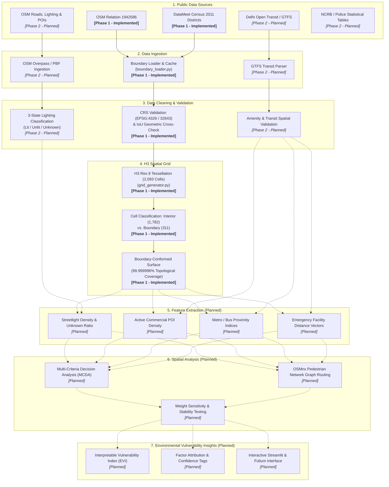
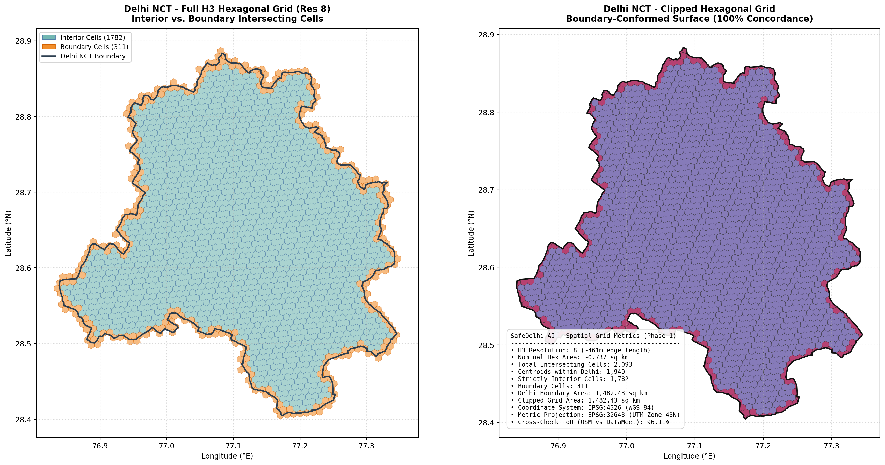

# SafeDelhi AI 🛡️

### A Data-Driven Geospatial Research Platform for Urban Environmental Safety Analysis

SafeDelhi AI is a data-driven **research project** focused on evaluating urban environmental conditions and infrastructure accessibility across the National Capital Territory (NCT) of Delhi, India.

By systematically synthesizing publicly available geographical, built-environment, and civic infrastructure datasets, the project develops an interpretable spatial framework to understand localized environmental vulnerability. Rather than making subjective or deterministic claims about an area being "safe" or "unsafe," SafeDelhi AI models the physical and spatial conditions of the urban landscape—such as street lighting coverage, pedestrian infrastructure, transit accessibility, natural surveillance proxies, and emergency service proximity—while explicitly highlighting data uncertainty and infrastructure deficits.

---

## 🎯 Project Objectives

- **Standardized Spatial Tessellation**: Partition Delhi into uniform discrete hexagonal units (Uber H3) to establish a rigorous, orientation-neutral baseline for urban analysis.
- **Multi-Source Data Synthesis**: Systematically verify, ingest, and cross-reference public datasets spanning transport networks, civic amenities, road topologies, and administrative boundaries.
- **Evidence-Based Environmental Modeling**: Quantify built-environment indicators that influence pedestrian vulnerability without relying on non-public, fabricated, or unverified crime telemetry.
- **Explainable Vulnerability Assessment**: Ensure all safety and risk metrics decompose into transparent, human-interpretable factors rather than opaque black-box scores.
- **Data Confidence & Uncertainty Accounting**: Distinguish verified infrastructure observations from missing data (e.g., classifying lighting into confirmed lit, confirmed unlit, and unmapped/unknown states).
- **Interactive Geospatial Visualization**: Communicate spatial findings through interactive, layered map interfaces and open diagnostic reports.

---

## 🏗️ System Architecture & Pipeline

SafeDelhi AI is organized into a modular geospatial pipeline. The diagram below illustrates the end-to-end architecture, clearly distinguishing **implemented Phase 1 components** from **planned components**:



---

## 📊 Phase 1 Results: Spatial Foundation & Boundary Verification

**Status: Completed & Verified**

Phase 1 established the spatial and mathematical foundation for the platform. The operational territory of Delhi was cross-checked against independent public data sources and tessellated into discrete hexagonal units.



### Verified Spatial Metrics

| Metric | Verified Value | Methodological Context |
|---|---:|---|
| **H3 Spatial Resolution** | `8` | Neighbourhood-scale spatial unit (comparable in footprint to an urban residential sector or mohalla). |
| **Total Intersecting Grid Cells** | `2,093` | Total cells intersecting the operational Delhi boundary polygon. |
| **Strictly Interior Cells** | `1,782` | Cells whose complete hexagonal geometry falls strictly inside Delhi. |
| **Boundary-Intersecting Cells** | `311` | Cells that intersect the outer administrative perimeter. |
| **Cells with Centroid in Delhi** | `1,940` | Cells whose geometric centroid lies within the NCT border. |
| **Unique Adjacent Neighbor Pairs** | `6,034` | Deduplicated adjacent face-sharing cell pairs verified via `h3.hex_ring(1)`. |
| **Mean Centroid Spacing** | `940.33 m` | Geodesic distance on WGS84 ellipsoid across all 6,034 neighbor pairs (Median: `933.31 m`, Min: `920.08 m`, Max: `966.41 m`, Std: `18.07 m`). |
| **Mean Hexagon Edge Length** | `542.91 m` | Geodesic edge length measured across 12,558 hexagon boundary segments (Median: `547.13 m`, Std: `10.54 m`). |
| **Planar Geometric Concordance** | `940.35 m` | $L \times \sqrt{3} = 542.91\text{ m} \times \sqrt{3} = 940.35\text{ m}$, confirming mathematical consistency with measured centroid spacing ($940.33\text{ m}$). |
| **Operational Boundary Area (OSM)** | `1,482.43 sq km` | Measured in UTM Zone 43N (`EPSG:32643`), closely matching the official Survey of India benchmark (~1,483 sq km). |
| **Reference Boundary Area (DataMeet)** | `1,504.36 sq km` | 9 Census 2011 districts dissolved into a unified outer polygon. |
| **Boundary Concordance (IoU)** | `96.11%` | Deterministic Jaccard index (Intersection over Union: `0.9611`) between OSM and DataMeet reference. |
| **Grid Topological Coverage** | `99.999996%` | Unary union of clipped cells ($1,482,426,330.09\text{ m}^2$) vs. boundary ($1,482,426,386.65\text{ m}^2$). |
| **Inter-Cell Overlap Area** | `0.00 sq m` | Sum of individual clipped cell areas identically equals their spatial union area. |
| **Automated Test Suite Status** | `14 / 14 Passed` | Unit, geometry, distance, topology, and reproducibility tests execute in <0.5s. |

> [!NOTE]
> **Understanding Geometric Coverage**: The 99.999996% topological coverage verifies the mathematical completeness of the geometric partitioning algorithm (zero overlapping cells and zero structural gaps across the interior). It confirms vector tessellation integrity; it does not independently establish the ground-truth physical accuracy of real-world borders, which remain subject to cadastral survey tolerances.

---

## 🗺️ Visual Assets

The repository contains two visual deliverables generated during Phase 1:

- **Static Diagnostic Visual**: [`reports/delhi_boundary_and_grid.png`](reports/delhi_boundary_and_grid.png) — High-resolution dual-panel diagnostic visual comparing unclipped H3 cell classifications (interior vs. boundary) with the conformed clipped surface and statistical telemetry.
- **Interactive Exploration Map**: [`reports/delhi_grid_interactive.html`](reports/delhi_grid_interactive.html) — Self-contained Leaflet.js interactive map featuring layer controls (boundary, full grid, clipped grid) and click/hover telemetry displaying H3 `cell_id`, centroid coordinates, and physical area.

---

## 🚀 Phase 2 Roadmap: Public Dataset Verification & Ingestion

**Status: Planned (Not Yet Implemented)**

Phase 2 will focus on the systematic identification, live verification, and ingestion of open public infrastructure datasets. **No vulnerability scoring or dataset integration has been performed yet.**

Planned dataset domains and verification protocols:

1. **Pedestrian & Road Network Topology**:
   - Extract walkable street networks using OpenStreetMap tags (`highway=footway`, `pedestrian`, `residential`, `primary`).
   - Construct a directed pedestrian graph using **OSMnx** and **NetworkX** to measure real network distance and detour ratios rather than Euclidean distances.
2. **Public Streetlight Infrastructure**:
   - Ingest streetlight tags (`lit=*`).
   - Implement an explicit **3-State Lighting Model**:
     - `confirmed_lit`: Recorded `lit=yes`.
     - `confirmed_unlit`: Recorded `lit=no`.
     - `unknown`: Missing or unrecorded lighting tags. Unmapped tags will directly decrease the cell's **Data Confidence Score** rather than artificially inflating its risk score.
3. **Public Transit Accessibility**:
   - Verify and ingest static GTFS / transit schedules from the Delhi Open Transit Data portal (`otd.delhi.gov.in`) and Delhi Metro Rail Corporation (DMRC) station feeds.
   - Calculate pedestrian network walk times to active bus stops and rapid transit hubs.
4. **Civic & Emergency Services**:
   - Map operational locations of Delhi Police stations, police posts, 24/7 pharmacies, and healthcare facilities.
   - Measure network distance vectors from cell centroids to nearest emergency facilities.
5. **Macro Contextual Crime Statistics**:
   - Extract district-level statistical tables from National Crime Records Bureau (NCRB) publications and Delhi Police annual statistical reports.
   - Strictly treat these aggregate statistics as broad contextual macro baselines. **District statistics will never be downsampled or disguised as micro-level street crime.**

---

## 🧰 Technology Stack

| Technology | Role & License | Architectural Application |
|---|---|---|
| **Python 3.9+** | Core Language (PSF) | Platform runtime and computational logic. |
| **GeoPandas** | Spatial Vector Processing (BSD 3-Clause) | Geometric operations, spatial joins, coordinate transformations. |
| **H3 (Python bindings)** | Discrete Global Grid (Apache 2.0) | Hierarchical hexagonal spatial indexing and tessellation. |
| **Shapely** | Planar Geometry Engine (BSD 3-Clause) | Polygon intersections, unary unions, topology verification. |
| **Pandas** | Tabular Data Processing (BSD 3-Clause) | Feature matrices, attribute manipulation, and aggregation. |
| **PyProj** | Cartographic Projections (OSI Approved) | Accurate transformations between WGS84 (`EPSG:4326`) and UTM Zone 43N (`EPSG:32643`). |
| **Folium / Leaflet.js** | Interactive Mapping (MIT) | Client-side interactive map visualization without commercial API keys. |
| **Matplotlib** | Diagnostic Cartography (PSF / BSD) | Static, headless diagnostic plotting and report generation. |
| **Pytest** | Automated Testing Framework (MIT) | Spatial assertions, boundary integrity tests, regression checks. |

---

## 📁 Project Structure

```text
SafeDelhi-AI/
├── config.py                                      # Global paths, spatial bounds & constants
├── requirements.txt                               # Pinned Phase 1 dependencies
├── README.md                                      # Project documentation & architectural specification
│
├── data/
│   ├── raw/
│   │   └── boundaries/
│   │       ├── datameet_delhi.geojson            # Census 2011 reference boundary (DataMeet)
│   │       ├── delhi_boundary.geojson            # Validated primary operational boundary
│   │       └── osm_delhi.geojson                 # OSM Relation 1942586 extract
│   └── processed/
│       ├── boundary_verification_report.json     # Empirical IoU and area verification audit
│       ├── delhi_grid_res8.geojson               # Complete H3 Res 8 hexagonal tessellation
│       ├── delhi_grid_res8_clipped.geojson       # Boundary-clipped visualization grid
│       └── reproducibility_metadata.json         # Exact dependency versions and spatial telemetry
│
├── reports/
│   ├── delhi_boundary_and_grid.png               # High-resolution static diagnostic visual
│   └── delhi_grid_interactive.html               # Interactive Folium map with layer controls
│
├── src/
│   ├── __init__.py
│   ├── ingestion/
│   │   ├── __init__.py
│   │   └── boundary_loader.py                    # Multi-source boundary fetching & validation
│   ├── spatial/
│   │   ├── __init__.py
│   │   ├── grid_generator.py                     # H3 grid tessellation, classification & clipping
│   │   └── visualizer.py                         # Matplotlib & Folium map generators
│   └── utils/
│       ├── __init__.py
│       └── logger.py                             # Standardized logging formatter
│
└── tests/
    ├── test_boundary.py                          # Boundary CRS, area, bbox & IoU assertions
    └── test_grid.py                              # Grid topology, H3 IDs, distance & coverage tests
```

---

## ⚙️ Getting Started

### 1. Clone the repository

```bash
git clone https://github.com/Fuzail-Ahm/SafeDelhi-AI.git
cd SafeDelhi-AI
```

### 2. Create and activate a virtual environment

```bash
python3 -m venv .venv
```

**macOS / Linux:**
```bash
source .venv/bin/activate
```

**Windows:**
```bash
.venv\Scripts\activate
```

### 3. Install Phase 1 dependencies

```bash
pip install --upgrade pip
pip install -r requirements.txt
```

### 4. Run the automated test suite

Execute all 14 unit, boundary validation, and spatial topology tests:

```bash
pytest -v
```

---

## 🔍 Research Principles and Limitations

SafeDelhi AI is built upon strict ethical and methodological constraints:

- **Evidence-Based Modeling**: The project strictly prohibits the fabrication of real-world crime events, safety incidents, or physical infrastructure locations.
- **Uncertainty Accounting**: Missing data tags (such as unmapped lighting in OSM) must not be assumed to represent negative infrastructure. Missing data decreases the confidence index of a cell rather than penalizing its environmental vulnerability score.
- **No Absolute Safety Labels**: The platform evaluates relative environmental risk and infrastructure vulnerability. It does **not** claim that any area is absolutely safe or unsafe, nor does it issue binary safe/unsafe neighborhood ratings.
- **Separation of Macro and Micro Data**: District-level aggregate crime statistics reflect broad reporting administrative trends and will never be represented as localized street-level safety indicators.
- **Contextual Under-Reporting**: Official crime statistics are subject to significant reporting barriers and social disparities. Environmental factors (such as lighting and transport access) are analyzed as civic built-environment audits rather than direct proxies for criminal behavior.
- **Privacy & Aggregation**: The system operates exclusively on aggregate spatial units (H3 cells) and publicly documented civic infrastructure. It does not track individuals or process private user telemetry.

---

## 🌍 Data Sources & Attribution

The current geographical baseline utilizes the following public datasets:

| Dataset | Provider | Stated License / Terms | Usage in Project |
|---|---|---|---|
| **Delhi Administrative Boundary** (Relation ID `1942586`) | [OpenStreetMap](https://www.openstreetmap.org/) | [Open Database License (ODbL) 1.0](https://opendatacommons.org/licenses/odbl/) | Primary operational boundary for spatial indexing and clipping. © OpenStreetMap contributors. |
| **India Districts (Census 2011)** | [DataMeet Community Maps](https://github.com/datameet/maps) | [Creative Commons Attribution 2.5 India (CC BY 2.5 IN)](https://creativecommons.org/licenses/by/2.5/in/) | Independent reference boundary for cross-validation and IoU concordance. |

### Licensing & Attribution Verification Status
- **Verified**: Upstream source URLs, retrieval dates, and geometric integrity for both boundary datasets have been verified live.
- **Needs Review Before Project Licensing**:
  1. Detailed compatibility between ODbL 1.0 (OpenStreetMap share-alike provisions) and CC BY 2.5 IN (DataMeet) when publishing combined derivative spatial vector files.
  2. Redistribution rights and terms of service for planned Phase 2 datasets (Delhi Open Transit GTFS feeds and government open data statistical tables).
  3. A formal project-level license will be designated once these upstream attribution and redistribution requirements are reviewed.

---

## 📌 Project Status

- **Completed**: Phase 1 — Spatial Foundation, Administrative Boundary Cross-Checking & H3 Tessellation.
- **Pending Approval**: Phase 2 — Public Dataset Ingestion, 3-State Lighting Model, and Open Transit Ingestion.

---

**SafeDelhi AI — Urban environmental safety research through transparent, explainable geospatial analysis.**
