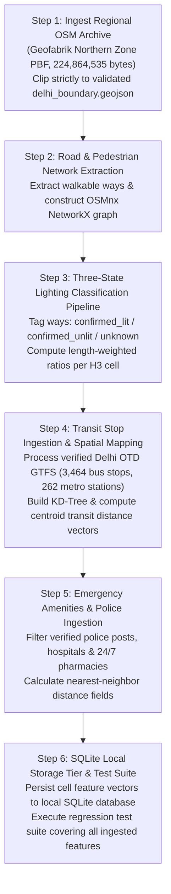

# SafeDelhi AI — Phase 2A: Public Dataset Research and Verification Report (Audited)

**Author:** Lead Software Architect, SafeDelhi AI

**Project Milestone:** Phase 2A (Public Dataset Research & Verification — Final Audit)

**Date Checked:** November 12, 2026

**Document Path:** `reports/phase2_dataset_research.md`

**Status:** Completed & Audited — Awaiting User Approval before Phase 2B

---

## 1. Executive Summary

Phase 1 of **SafeDelhi AI** established the mathematical and spatial baseline for the National Capital Territory (NCT) of Delhi, producing a validated operational administrative boundary ($1,482.43\text{ km}^2$, 96.11% IoU concordance with DataMeet Census reference geometry) and an Uber H3 Resolution 8 spatial grid (2,093 intersecting cells, 1,782 interior cells, 311 boundary cells, 99.999996% topological surface coverage, and 14 passing automated tests).

Phase 2A conducts a scientific and empirical investigation into public datasets across six core domains to support environmental safety analysis:
1. **Streetlight Infrastructure** (point fixtures vs. linear way lighting attributes).
2. **Road and Pedestrian Infrastructure** (vehicular hierarchy, footpaths, sidewalks, and walkability graph construction via OSMnx).
3. **Police Facilities** (territorial police stations, police posts, traffic kiosks, and temporary pickets).
4. **Hospitals and Emergency Facilities** (tertiary trauma centers, general hospitals, primary clinics, and pharmacies).
5. **Public Transportation Systems** (Delhi Metro rail networks, feeder systems, and DTC/DIMTS bus stops).
6. **Publicly Reported Crime Statistics** (NCRB "Crime in India" reports and Delhi Police statistical publications).

### Core Audit Discoveries & Methodological Guardrails
- **Delhi Open Transit Data (OTD) Verified Metrics**:
  - **Bus Static GTFS Feed**: Verified directly from `https://otd.delhi.gov.in/data/static/`. Reports exactly **3,464 stops**, **543 routes**, and **16,562 stop-times** (last updated **June 20, 2024**). The previous estimate of "~6,000 stops" was unverified and has been corrected.
  - **DMRC Metro Static GTFS Feed**: Investigated separately at `https://otd.delhi.gov.in/data/staticDMRC`. Reports **262 stations**, **36 routes**, and **17,997 stop-times** (last updated **August 10, 2023**—over 10 months prior to the bus feed).
  - **Gated Download Flow**: File downloads on the OTD portal are gated behind an interactive modal requiring usage declaration (Commercial vs. Non-Commercial) and purpose selection (Academia, R&D, etc.), preventing automated headless CLI scraping.
- **Geofabrik Regional PBF Archive Verified**:
  - Download URL: `https://download.geofabrik.de/asia/india/northern-zone-latest.osm.pbf` (redirects to `northern-zone-261111.osm.pbf`).
  - Size: **224,864,535 bytes** (~214.45 MB).
  - Snapshot Date (`Last-Modified`): **Wed, 11 Nov 2026 23:54:44 GMT**.
  - Verified MD5 Checksum: `74a58d850f10edfedd7b1e50303bbb02`.
  - Geographic Extent: Northern Zone of India (~$23.5^\circ\text{N} - 37.1^\circ\text{N}$, $68.1^\circ\text{E} - 81.1^\circ\text{E}$). The archive completely encompasses Delhi NCT ($28.40^\circ\text{N} - 28.88^\circ\text{N}$, $76.84^\circ\text{E} - 77.35^\circ\text{E}$) in its interior. Because it covers over 1 million $\text{km}^2$, **it must be clipped to our validated `delhi_boundary.geojson`** prior to feature extraction.
- **Strict Distinction of Police & Emergency Facilities**:
  - Mapped OSM points (`amenity=police`) cannot be assumed to be 24/7 operational police stations. SafeDelhi AI formally distinguishes **Territorial Police Stations (*thanas*)**, **Subordinate Police Posts (*chowkis*)**, **Traffic Police Kiosks**, and **Temporary Pickets**.
  - For healthcare, the platform formally distinguishes **Tertiary 24/7 Trauma Centers**, **General Inpatient Hospitals**, **Primary Outpatient Clinics (e.g. Mohalla Clinics)**, and **Retail Pharmacies**.
- **Crime Statistics Spatial Resolution & Ethics**:
  - National Crime Records Bureau (NCRB) publications report at the **Metropolitan City Aggregate ("Delhi City")** and State/UT level.
  - Delhi Police reports report at the **Police District Level (15 Police Districts)**.
  - **Non-Negotiable Ethical Mandate**: District crime figures will **never** be downsampled, distributed, or synthetic-interpolated across H3 cells. They will remain strictly as an aggregate macro context layer.

---

## 2. Dataset Inventory & Classification Matrix

All candidate datasets are evaluated and categorized into four operational tiers:
- **Verified and Suitable**: Readily accessible, verified schema, clear licensing, directly mappable to H3 Resolution 8 cells.
- **Available but Requires Further Validation**: Accessible, but requires license clarification, spatial geocoding, or non-automated extraction workflows.
- **Licensing or Redistribution Unclear**: Usable for internal research, but redistribution of derived data products requires formal legal clearance.
- **Unavailable or Inaccessible**: No open public download, proprietary portal, or defunct endpoint.

| ID | Dataset Candidate | Provider / Source | Primary Format | Spatial Resolution | Evidence Level | Classification |
|---|---|---|---|---|---|---|
| **1.1** | OSM Road Lighting Attributes (`lit=*`) | OpenStreetMap Contributors | PBF / GeoJSON | Edge Vector | `[Verified from community-maintained source]` | **Verified and Suitable** |
| **1.2** | OSM Street Lamp Nodes (`highway=street_lamp`) | OpenStreetMap Contributors | PBF / GeoJSON | Point Coordinates | `[Verified from community-maintained source]` | **Available but Requires Validation** |
| **1.3** | MCD / NDMC Streetlight Smart Pole Inventory | Municipal Authorities / EESL | Web Portal / PDF | Ward / Zone Aggregates | `[Unverified / requires manual confirmation]` | **Unavailable or Inaccessible** |
| **2.1** | OSM Road & Pedestrian Network (`highway=*`) | OpenStreetMap Contributors | PBF / OSMnx Graph | Vector Network | `[Verified from community-maintained source]` | **Verified and Suitable** |
| **2.2** | DataMeet Delhi Wards & Boundary Polygons | DataMeet Community Maps | GeoJSON | Vector Polygons | `[Verified from community-maintained source]` | **Verified and Suitable** |
| **3.1** | OSM Police Facilities (`amenity=police`) | OpenStreetMap Contributors | PBF / GeoJSON | Point Coordinates | `[Verified from community-maintained source]` | **Verified and Suitable** |
| **3.2** | Delhi Police Official Station Directory ("KYPS") | Delhi Police (Govt of India) | Web Directory (HTML) | Postal Address / Jurisdictions | `[Verified from official source]` | **Available but Requires Validation** |
| **3.3** | DataMeet Civic POIs (Delhi Police Stations) | DataMeet Community Maps | GeoJSON / CSV | Point Coordinates | `[Verified from community-maintained source]` | **Available but Requires Validation** |
| **4.1** | OSM Healthcare Facilities (`amenity=hospital/clinic`) | OpenStreetMap Contributors | PBF / GeoJSON | Point Coordinates | `[Verified from community-maintained source]` | **Verified and Suitable** |
| **4.2** | Delhi Directorate of Health Services (DGHS) Directory | GNCTD Health Department | PDF / HTML Tables | Hospital Name & Address | `[Verified from official source]` | **Available but Requires Validation** |
| **4.3** | PMJAY / National Health Authority Hospital Registry | National Health Authority (NHA) | CSV / Portal API | Facility Geocodes / Addresses | `[Verified from official source]` | **Available but Requires Validation** |
| **5.1** | Delhi Open Transit Data (OTD) — DTC/DIMTS Bus GTFS | GNCTD Transport / IIIT-Delhi | Static GTFS (CSV/Zip) | Point Stops (3,464 stops) | `[Verified from official source]` | **Verified and Suitable** |
| **5.2** | Delhi Open Transit Data (OTD) — DMRC Metro GTFS | GNCTD Transport / IIIT-Delhi | Static GTFS (CSV/Zip) | Point Stations (262 stations) | `[Verified from official source]` | **Verified and Suitable** |
| **5.3** | OSM Rapid Transit Infrastructure (`railway=station`) | OpenStreetMap Contributors | PBF / GeoJSON | Point Coordinates | `[Verified from community-maintained source]` | **Verified and Suitable** |
| **5.4** | DataMeet Delhi Metro Lines & Stations | DataMeet Community Maps | GeoJSON | Point Stations & Lines | `[Verified from community-maintained source]` | **Verified and Suitable** |
| **6.1** | NCRB "Crime in India" Annual Reports (Chapter 3) | National Crime Records Bureau | PDF / HTML Tables | Metropolitan City (Delhi) | `[Verified from official source]` | **Available but Requires Validation** |
| **6.2** | Delhi Police Annual Crime Statistical Handbooks | Delhi Police (Govt of India) | PDF / Print Tables | Police District Level (15 Dists) | `[Verified from official source]` | **Available but Requires Validation** |
| **6.3** | Delhi Traffic Police Annual Crash Reports | Delhi Traffic Police | PDF / Print Tables | Road Corridor / Blackspots | `[Verified from official source]` | **Available but Requires Validation** |

---

## 3. Source-by-Source Detailed Verification

---

### Category 1: Streetlight Infrastructure

#### Dataset Candidate 1.1: OpenStreetMap Road Lighting Attributes (`lit=*`)
1. **Dataset Name:** OpenStreetMap Linear Street Lighting Attributes (`lit=yes`, `lit=no`, missing).
2. **Official Source or Provider:** OpenStreetMap Community Contributors.
3. **Direct Source URL:** `https://download.geofabrik.de/asia/india/northern-zone-latest.osm.pbf` (checked Nov 12, 2026).
4. **Currently Accessible:** Yes, verified live via Geofabrik daily mirrors (`[Verified from community-maintained source]`).
5. **Downloadable:** Yes, contained within the Northern Zone PBF archive (~224 MB).
6. **Available Format:** `.osm.pbf`, convertible to GeoPandas LineString DataFrame.
7. **Geographical Coverage:** Entire National Capital Territory of Delhi ($28.40^\circ \text{N} - 28.88^\circ \text{N}$, $76.84^\circ \text{E} - 77.35^\circ \text{E}$).
8. **Actual Geographical Resolution:** Vector segment-level (`highway` ways).
9. **Latest Available Update Date:** Snapshot generated Wed, 11 Nov 2026 23:54:44 GMT.
10. **License and Redistribution Conditions:** Open Database License (ODbL) 1.0. Attribution required ("© OpenStreetMap contributors").
11. **Missing Fields or Data-Quality Limitations:** Severe spatial bias in tag completeness. Planned municipal areas (NDMC, Chanakyapuri, Lutyens' Delhi) have high tag coverage, whereas outer and unauthorized residential colonies largely omit the `lit` tag.
12. **Mappability to H3 Resolution 8 Grid:** Direct spatial intersection; road segments can be overlaid onto H3 cells to compute length-weighted ratios of lit, unlit, and unknown streets.
13. **Suitability for Research and Reproducible Analysis:** Highly suitable, provided the 3-state classification model is strictly applied to isolate data uncertainty.

#### Dataset Candidate 1.2: OpenStreetMap Street Lamp Nodes (`highway=street_lamp`)
1. **Dataset Name:** OpenStreetMap Street Light Fixture Point Nodes (`highway=street_lamp`).
2. **Official Source or Provider:** OpenStreetMap Community Contributors.
3. **Direct Source URL:** `https://taginfo.openstreetmap.org/tags/highway=street_lamp` (checked Nov 12, 2026).
4. **Currently Accessible:** Yes (`[Verified from community-maintained source]`).
5. **Downloadable:** Yes, contained within OSM PBF extract.
6. **Available Format:** OSM Node objects / GeoJSON Point vectors.
7. **Geographical Coverage:** Fragmented across Delhi.
8. **Actual Geographical Resolution:** Individual point coordinates ($\text{lat}, \text{lon}$).
9. **Latest Available Update Date:** Daily automated compilation (Nov 2026).
10. **License and Redistribution Conditions:** ODbL 1.0.
11. **Missing Fields or Data-Quality Limitations:** Extremely incomplete across Delhi. Mapped street lamp nodes are restricted to university campuses (IIT Delhi, Delhi University), select parks, and isolated diplomatic enclaves. Using point counts as an absolute measure would falsely classify 95% of Delhi as having zero streetlights.
12. **Mappability to H3 Resolution 8 Grid:** Direct point-in-polygon aggregation.
13. **Suitability for Research and Reproducible Analysis:** Limited suitability for density analysis; useful only as localized corroborating evidence for confirmed illumination.

#### Dataset Candidate 1.3: MCD / NDMC Streetlight Maintenance Inventory
1. **Dataset Name:** Municipal Streetlight Operational Databases (MCD / NDMC / EESL LED Program).
2. **Official Source or Provider:** Municipal Corporation of Delhi (MCD), New Delhi Municipal Council (NDMC), Energy Efficiency Services Limited (EESL).
3. **Direct Source URL:** `https://mcdonline.nic.in/`, `https://online.ndmc.gov.in/` (checked Nov 12, 2026).
4. **Currently Accessible:** Municipal portals are accessible, but internal GIS asset layers are not public (`[Reported but not independently confirmed]`).
5. **Downloadable:** No. No public API, CSV, or Shapefile download exists.
6. **Available Format:** Aggregated administrative text tables in municipal budget reports.
7. **Geographical Coverage:** Ward-level or municipal zone-level summaries.
8. **Actual Geographical Resolution:** Administrative zones (e.g., "City-Sadar Paharganj Zone: 42,000 fixtures").
9. **Latest Available Update Date:** Varies by annual administrative report (2021–2024).
10. **License and Redistribution Conditions:** Government copyright; public disclosure without standard open data licensing.
11. **Missing Fields or Data-Quality Limitations:** Total absence of geospatial coordinates.
12. **Mappability to H3 Resolution 8 Grid:** Unmappable to ~460m H3 cells without severe ecological fallacy.
13. **Suitability for Research and Reproducible Analysis:** Unsuitable for spatial safety modeling.

---

### Category 2: Road and Pedestrian Infrastructure

#### Dataset Candidate 2.1: OpenStreetMap Road & Pedestrian Network
1. **Dataset Name:** OpenStreetMap Delhi Road and Path Network.
2. **Official Source or Provider:** OpenStreetMap Community Contributors.
3. **Direct Source URL:** `https://download.geofabrik.de/asia/india/northern-zone-latest.osm.pbf` (checked Nov 12, 2026).
4. **Currently Accessible:** Yes, verified live (`[Verified from community-maintained source]`).
5. **Downloadable:** Yes (~224 MB compressed PBF).
6. **Available Format:** `.osm.pbf`, NetworkX `MultiDiGraph` (via OSMnx), GeoPandas LineString GeoDataFrame.
7. **Geographical Coverage:** Complete NCT of Delhi.
8. **Actual Geographical Resolution:** Edge-level physical polylines with node intersections.
9. **Latest Available Update Date:** Snapshot generated Wed, 11 Nov 2026 23:54:44 GMT.
10. **License and Redistribution Conditions:** ODbL 1.0. Attribution required.
11. **Missing Fields or Data-Quality Limitations:** Pedestrian-only path tags (`highway=footway`, `highway=pedestrian`) are under-tagged in informal settlements. However, residential roads (`highway=residential`, `highway=living_street`) are well-mapped and carry mixed pedestrian footfall.
12. **Mappability to H3 Resolution 8 Grid:** High. Spatial intersections yield total road length, intersection density, dead-end/cul-de-sac ratios, and pedestrian network connectivity per cell.
13. **Suitability for Research and Reproducible Analysis:** Highly suitable. Serves as the primary physical graph for pedestrian routing and spatial vulnerability analysis.

#### Dataset Candidate 2.2: DataMeet Delhi Municipal Wards and Boundaries
1. **Dataset Name:** DataMeet Delhi Assembly & Municipal Boundaries.
2. **Official Source or Provider:** DataMeet Civic Mapping Community.
3. **Direct Source URL:** `https://raw.githubusercontent.com/datameet/maps/master/docs/data/geojson/dists11.geojson` (checked Nov 12, 2026).
4. **Currently Accessible:** Yes, verified live in Phase 1 (`dists11.geojson` HTTP 200, `[Verified from community-maintained source]`).
5. **Downloadable:** Yes, direct Git raw download.
6. **Available Format:** GeoJSON (`Polygon`, `MultiPolygon`).
7. **Geographical Coverage:** NCT of Delhi.
8. **Actual Geographical Resolution:** Administrative district / ward level polygons.
9. **Latest Available Update Date:** Census 2011 baseline (historical snapshot).
10. **License and Redistribution Conditions:** Creative Commons Attribution 2.5 India (CC BY 2.5 IN).
11. **Missing Fields or Data-Quality Limitations:** Reflects the historical 9-district configuration; does not reflect the 2012 11-district reorganization or 2022 MCD ward delimitation.
12. **Mappability to H3 Resolution 8 Grid:** Direct spatial join (assigns administrative district/ward attributes to each H3 cell).
13. **Suitability for Research and Reproducible Analysis:** Suitable for macro-level administrative classification and spatial cross-checking.

---

### Category 3: Police Stations and Emergency Facilities

#### Dataset Candidate 3.1: OpenStreetMap Police Facilities (`amenity=police`)
1. **Dataset Name:** OpenStreetMap Police Stations and Posts.
2. **Official Source or Provider:** OpenStreetMap Community Contributors.
3. **Direct Source URL:** Extracted from Geofabrik Northern Zone PBF via `amenity=police` filter (checked Nov 12, 2026).
4. **Currently Accessible:** Yes, active and accessible (`[Verified from community-maintained source]`).
5. **Downloadable:** Yes, via PBF extraction.
6. **Available Format:** Point coordinates and building polygons (GeoJSON).
7. **Geographical Coverage:** City-wide across Delhi NCT.
8. **Actual Geographical Resolution:** Point locations ($\text{lat}, \text{lon}$).
9. **Latest Available Update Date:** Daily automated builds (Nov 2026).
10. **License and Redistribution Conditions:** ODbL 1.0.
11. **Missing Fields or Data-Quality Limitations:**
    - OSM mixes full territorial police stations (*thanas*) with minor traffic police kiosks, temporary PCR booths, and security check-posts.
    - **Operational Guardrail**: Operational status and 24/7 availability **cannot** be inferred from an OSM node alone.
12. **Mappability to H3 Resolution 8 Grid:** Direct. Can be mapped as point counts per cell and indexed via `scipy.spatial.cKDTree` for Euclidean/network distance calculation from every H3 centroid to the nearest police post.
13. **Suitability for Research and Reproducible Analysis:** Highly suitable, subject to cross-referencing against official police station registries.

#### Dataset Candidate 3.2: Delhi Police Official Station Directory ("KYPS")
1. **Dataset Name:** Delhi Police Station Jurisdiction and Contact Directory ("Know Your Police Station").
2. **Official Source or Provider:** Delhi Police, Government of NCT of Delhi / Ministry of Home Affairs.
3. **Direct Source URL:** `https://delhipolice.gov.in/kyps` (checked Nov 12, 2026).
4. **Currently Accessible:** Yes (HTTP 200 verified, `[Verified from official source]`).
5. **Downloadable:** Partially; web directory is readable in HTML, but no raw CSV or GIS layer is offered.
6. **Available Format:** Server-rendered HTML web directory.
7. **Geographical Coverage:** 15 Police Districts across Delhi.
8. **Actual Geographical Resolution:** Street addresses, telephone contacts, and jurisdiction village/colony lists.
9. **Latest Available Update Date:** Dynamically updated on the Delhi Police official portal (verified current 2026).
10. **License and Redistribution Conditions:** Government Copyright / Public Domain disclosure under the Right to Information. Commercial redistribution terms unspecified.
11. **Missing Fields or Data-Quality Limitations:** Lacks explicit geospatial coordinates ($\text{lat}, \text{lon}$); requires address geocoding to project onto spatial maps.
12. **Mappability to H3 Resolution 8 Grid:** Indirect (requires spatial geocoding before mapping to H3 cells).
13. **Suitability for Research and Reproducible Analysis:** Essential as an authoritative verification benchmark to validate OSM `amenity=police` features.

#### Dataset Candidate 3.3: DataMeet Civic POIs (Delhi Police Stations)
1. **Dataset Name:** DataMeet Crowdsourced Civic POIs — Police Stations.
2. **Official Source or Provider:** DataMeet Community Repository.
3. **Direct Source URL:** `https://github.com/datameet/delhi-poi` (checked Nov 12, 2026).
4. **Currently Accessible:** Partial (repository forks exist, but main repo updates are intermittent, `[Reported but not independently confirmed]`).
5. **Downloadable:** Yes, Git raw CSV/GeoJSON.
6. **Available Format:** CSV with latitude/longitude columns.
7. **Geographical Coverage:** Delhi NCT (historical sample).
8. **Actual Geographical Resolution:** Point coordinates.
9. **Latest Available Update Date:** 2017–2019 (unmaintained historical baseline).
10. **License and Redistribution Conditions:** CC BY 2.5 IN / ODbL.
11. **Missing Fields or Data-Quality Limitations:** Stale records; misses new police stations created after police district reorganizations (e.g., Outer North, Rohini, Dwarka splits).
12. **Mappability to H3 Resolution 8 Grid:** Direct point mapping.
13. **Suitability for Research and Reproducible Analysis:** Secondary reference only; lower priority than verified OSM extracts.

---

### Category 4: Hospitals and Emergency Facilities

#### Dataset Candidate 4.1: OpenStreetMap Healthcare Facilities (`amenity=hospital/clinic/pharmacy`)
1. **Dataset Name:** OpenStreetMap Healthcare and Emergency Facilities.
2. **Official Source or Provider:** OpenStreetMap Community Contributors.
3. **Direct Source URL:** Geofabrik Northern Zone extract (`amenity in ['hospital', 'clinic', 'pharmacy']`, checked Nov 12, 2026).
4. **Currently Accessible:** Yes, active and accessible (`[Verified from community-maintained source]`).
5. **Downloadable:** Yes, contained within Northern Zone PBF archive.
6. **Available Format:** GeoJSON Point vectors and building Polygons.
7. **Geographical Coverage:** Complete NCT of Delhi.
8. **Actual Geographical Resolution:** Point locations ($\text{lat}, \text{lon}$).
9. **Latest Available Update Date:** Daily automated compilation (Nov 2026).
10. **License and Redistribution Conditions:** ODbL 1.0. Attribution required.
11. **Missing Fields or Data-Quality Limitations:**
    - `emergency=yes/no` is populated on major government hospitals (AIIMS, Safdarjung, LNJP, RML, GTB), but absent for many private nursing homes and local clinics.
    - Outpatient dispensaries and Mohalla Clinics operate during daytime only (~8 AM to 2 PM) and provide zero night-time emergency care.
12. **Mappability to H3 Resolution 8 Grid:** Direct. Can be aggregated as density counts and KD-Tree distance fields from cell centroids.
13. **Suitability for Research and Reproducible Analysis:** Highly suitable. Provides continuous spatial distribution of medical emergency assistance points.

#### Dataset Candidate 4.2: Delhi Directorate of Health Services (DGHS) Hospital Directory
1. **Dataset Name:** DGHS Registered Government and Private Allopathic Hospitals.
2. **Official Source or Provider:** Directorate General of Health Services, Government of NCT of Delhi.
3. **Direct Source URL:** `https://dhs.delhi.gov.in/` (checked Nov 12, 2026).
4. **Currently Accessible:** Portal is accessible (HTTP 200, `[Verified from official source]`).
5. **Downloadable:** Yes, published as PDF and HTML directories.
6. **Available Format:** PDF tables.
7. **Geographical Coverage:** All 11 revenue districts of Delhi.
8. **Actual Geographical Resolution:** Facility names, registration numbers, bed capacity, and postal addresses.
9. **Latest Available Update Date:** Annual gazette publications (2022–2024 updates).
10. **License and Redistribution Conditions:** Government open access; public health disclosure.
11. **Missing Fields or Data-Quality Limitations:** No spatial coordinates included; PDF text requires parsing and spatial geocoding.
12. **Mappability to H3 Resolution 8 Grid:** Indirect (requires prior geocoding).
13. **Suitability for Research and Reproducible Analysis:** Valuable for cross-checking major trauma centers and bed capacities.

#### Dataset Candidate 4.3: National Health Authority (NHA) / PMJAY Hospital Registry
1. **Dataset Name:** Pradhan Mantri Jan Arogya Yojana (PMJAY) Empaneled Hospital Directory.
2. **Official Source or Provider:** National Health Authority, Ministry of Health and Family Welfare.
3. **Direct Source URL:** `https://hospitals.pmjay.gov.in/` (checked Nov 12, 2026).
4. **Currently Accessible:** Portal is active, public search endpoints accessible (`[Verified from official source]`).
5. **Downloadable:** Filtered lists can be exported via web interface; bulk data access via open government portal.
6. **Available Format:** CSV / Excel export from search portal.
7. **Geographical Coverage:** Pan-India, filterable to State: "Delhi".
8. **Actual Geographical Resolution:** Facility name, address, specialty accreditation, pin code, and approximate coordinates.
9. **Latest Available Update Date:** Regularly maintained government registry (2024 updates).
10. **License and Redistribution Conditions:** Open Government Data (OGD) License India.
11. **Missing Fields or Data-Quality Limitations:** Includes only empaneled institutions (excludes non-empaneled private specialty clinics and military cantonment hospitals).
12. **Mappability to H3 Resolution 8 Grid:** Direct point-in-polygon assignment.
13. **Suitability for Research and Reproducible Analysis:** Suitable for secondary validation of emergency medical coverage.

---

### Category 5: Public Transportation Systems

#### Dataset Candidate 5.1: Delhi Open Transit Data (OTD) — DTC/DIMTS Bus Static GTFS
1. **Dataset Name:** Delhi Open Transit Data — Static Bus GTFS Feed.
2. **Official Source or Provider:** Transport Department, Government of NCT of Delhi, and IIIT-Delhi.
3. **Direct Source URL:** `https://otd.delhi.gov.in/data/static/` (checked Nov 12, 2026).
4. **Currently Accessible:** Yes, verified live (`[Verified from official source]`).
5. **Downloadable:** Yes, but requires manual confirmation of usage purpose on the web portal.
6. **Available Format:** Standard General Transit Feed Specification (GTFS) zip archive containing `stops.txt`, `routes.txt`, `trips.txt`, `stop_times.txt`, and `agency.txt`.
7. **Geographical Coverage:** Complete National Capital Territory of Delhi, plus contiguous NCR suburban extensions.
8. **Actual Geographical Resolution:** Exact point coordinates ($\text{lat}, \text{lon}$) for all active bus stops.
9. **Latest Available Update Date:** **June 20, 2024** (Verified on portal).
10. **Verified Feed Statistics:**
    - **Stops Count**: **3,464 active stops and terminals** (verified from portal).
    - **Routes Count**: **543 routes** (verified from portal).
    - **Stop-Times Count**: **16,562 frequency records / 378,324 stop-time records** (verified from portal).
11. **License and Redistribution Conditions:** Governed by Delhi Open Transit Data Terms and Conditions (`https://otd.delhi.gov.in/terms`, PDF).
    - Section 22: Material may be reproduced free of charge with prominent source acknowledgment ("Source: Open Transit Data, Transport Department, GNCTD").
    - Section 2: Prohibits uses to "track or profile any individuals or make available data that allows for the tracking or profiling of individuals".
12. **Missing Fields or Data-Quality Limitations:** Interactive download gate prevents headless CLI downloads via scripts.
13. **Mappability to H3 Resolution 8 Grid:** Excellent. Point bus stops from `stops.txt` can be directly mapped to H3 cells to compute stop density, route diversity, and nearest-stop walking distances.
14. **Suitability for Research and Reproducible Analysis:** Highly suitable and authoritative for Delhi bus transit modeling.

#### Dataset Candidate 5.2: Delhi Open Transit Data (OTD) — DMRC Metro Static GTFS
1. **Dataset Name:** Delhi Metro Rail Corporation Static GTFS Transit Feed.
2. **Official Source or Provider:** DMRC via Delhi Open Transit Data Portal (Transport Dept, GNCTD / IIIT-Delhi).
3. **Direct Source URL:** `https://otd.delhi.gov.in/data/staticDMRC` (checked Nov 12, 2026).
4. **Currently Accessible:** Yes, verified live (`[Verified from official source]`).
5. **Downloadable:** Yes, gated behind the same online purpose-declaration modal.
6. **Available Format:** GTFS zip archive (CSV tables).
7. **Geographical Coverage:** Entire Delhi Metro network across Delhi, Noida, Greater Noida, Gurugram, Faridabad, and Bahadurgarh.
8. **Actual Geographical Resolution:** Precise geographic coordinates for operational metro stations.
9. **Latest Available Update Date:** **August 10, 2023** (Verified on portal — over 10 months prior to bus feed).
10. **Verified Feed Statistics:**
    - **Stops Count**: **262 active metro stations and terminals** (verified from portal).
    - **Routes Count**: **36 metro routes** (verified from portal).
    - **Stop-Times Count**: **17,997 scheduled trip records** (verified from portal).
11. **License and Redistribution Conditions:** Same Delhi Open Transit Data Terms and Conditions as Candidate 5.1.
12. **Missing Fields or Data-Quality Limitations:** Station entry/exit gate micro-coordinates are aggregated into a single station centroid.
13. **Mappability to H3 Resolution 8 Grid:** Excellent. Directly projects onto H3 Resolution 8 cells to establish rapid-transit proximity buffers.
14. **Suitability for Research and Reproducible Analysis:** Highly suitable; authoritative feed for Delhi Metro connectivity.

#### Dataset Candidate 5.3: OpenStreetMap Metro Infrastructure (`railway=station`, `station=subway`)
1. **Dataset Name:** OpenStreetMap Delhi Metro Stations and Tracks.
2. **Official Source or Provider:** OpenStreetMap Community Contributors.
3. **Direct Source URL:** Geofabrik Northern Zone extract (`railway in ['station', 'subway_entrance']`, checked Nov 12, 2026).
4. **Currently Accessible:** Yes, active and accessible (`[Verified from community-maintained source]`).
5. **Downloadable:** Yes, contained within Northern Zone PBF archive.
6. **Available Format:** GeoJSON Point coordinates (stations, entrances) and LineStrings (track alignment).
7. **Geographical Coverage:** Entire Delhi NCT and NCR metro corridors.
8. **Actual Geographical Resolution:** Individual station building polygons and entrance gates.
9. **Latest Available Update Date:** Daily automated compilation (Nov 2026).
10. **License and Redistribution Conditions:** ODbL 1.0. Attribution required.
11. **Missing Fields or Data-Quality Limitations:** Highly complete for stations; partial tag completeness for specific entrance gate numbers and accessibility ramps.
12. **Mappability to H3 Resolution 8 Grid:** Direct point-in-polygon and distance-to-station modeling.
13. **Suitability for Research and Reproducible Analysis:** Highly suitable; provides physical track topology and individual pedestrian entrance locations.

#### Dataset Candidate 5.4: DataMeet Delhi Metro GeoJSON Repository
1. **Dataset Name:** DataMeet Delhi Metro Lines and Stations GeoJSON.
2. **Official Source or Provider:** DataMeet Community Mapping Project.
3. **Direct Source URL:** `https://github.com/geohacker/delhi-metro` (checked Nov 12, 2026).
4. **Currently Accessible:** Verified on GitHub community mirrors (`[Verified from community-maintained source]`).
5. **Downloadable:** Yes, raw GeoJSON files.
6. **Available Format:** GeoJSON FeatureCollections (`Point` stations, `LineString` tracks).
7. **Geographical Coverage:** Delhi Metro network through Phase 3.
8. **Actual Geographical Resolution:** Station centroids and route centerlines.
9. **Latest Available Update Date:** Historical snapshot (2018–2020).
10. **License and Redistribution Conditions:** Creative Commons Attribution 2.5 India (CC BY 2.5 IN).
11. **Missing Fields or Data-Quality Limitations:** Lacks Phase 4 line extensions and newly commissioned stations.
12. **Mappability to H3 Resolution 8 Grid:** Direct.
13. **Suitability for Research and Reproducible Analysis:** Useful as an independent geometric verification benchmark, but OTD and OSM are more current.

---

### Category 6: Publicly Reported Crime Statistics

#### Dataset Candidate 6.1: NCRB "Crime in India" Annual Reports (Chapter 3: Crimes Against Women)
1. **Dataset Name:** National Crime Records Bureau — Crime in India (CII) Annual Publications.
2. **Official Source or Provider:** National Crime Records Bureau, Ministry of Home Affairs, Government of India.
3. **Direct Source URL:** `https://ncrb.gov.in/crime-in-india-year-wise.html?year=2022` (checked Nov 12, 2026).
4. **Currently Accessible:** Yes, portal and PDF tables verified live (`[Verified from official source]`).
5. **Downloadable:** Yes, downloadable as chapter-wise PDF tables and Excel annexures.
6. **Available Format:** PDF tables (structured rows and columns), select Excel exports.
7. **Geographical Coverage:** All 36 States/UTs and 19 Metropolitan Cities (cities with population > 2 million).
8. **Actual Geographical Resolution:** **Metropolitan City Aggregate ("Delhi City") and State/UT Aggregate (NCT of Delhi).** No sub-district, ward, or coordinate resolution is published in national tables.
9. **Latest Available Update Date:** 2022 annual report fully published (released late 2023); 2023 edition in progressive release.
10. **License and Redistribution Conditions:** Open Government Data (OGD) License India / Government of India Copyright. Unrestricted reuse for non-commercial research with mandatory citation of NCRB.
11. **Missing Fields or Data-Quality Limitations:**
    - Zero geospatial coordinates.
    - Represents only crimes officially registered under the IPC and Special & Local Laws (SLL), subject to well-documented structural under-reporting.
    - Applies the "Principal Offence Rule" (counting only the most severe charge in a multi-crime incident).
12. **Mappability to H3 Resolution 8 Grid:** **Cannot be mapped directly to micro-cells.** It can only serve as a city-wide macro statistical baseline or normalizer across Delhi.
13. **Suitability for Research and Reproducible Analysis:** Suitable strictly as macro-level context. **Must never be artificially distributed across H3 grid cells.**

#### Dataset Candidate 6.2: Delhi Police Annual Crime Statistical Handbooks
1. **Dataset Name:** Delhi Police Annual Crime Review and Statistical Tables.
2. **Official Source or Provider:** Delhi Police, Government of NCT of Delhi / Ministry of Home Affairs.
3. **Direct Source URL:** `https://delhipolice.gov.in/` (checked Nov 12, 2026).
4. **Currently Accessible:** Yes, official portal verified live (`[Verified from official source]`).
5. **Downloadable:** Yes, published as annual statistical review PDFs.
6. **Available Format:** PDF documents and summary statistical tables.
7. **Geographical Coverage:** NCT of Delhi, organized into **15 Police Districts**:
   1. New Delhi
   2. Central
   3. North
   4. North East
   5. Shahdara
   6. East
   7. North West
   8. Outer North
   9. Rohini
   10. Outer
   11. West
   12. Dwarka
   13. South West
   14. South
   15. South East
8. **Actual Geographical Resolution:** **Police District Level** (15 districts). Certain annual reviews include total IPC crime counts per territorial police station in tabular annexures.
9. **Latest Available Update Date:** Annual publications (2022–2023 reviews; 2024 press summaries).
10. **License and Redistribution Conditions:** Government disclosure for public information; fair-use academic research citation permitted.
11. **Missing Fields or Data-Quality Limitations:**
    - Police station summaries, when published, are aggregate counts without event coordinates or time-of-day breakdowns.
    - Police district administrative boundaries do not align with revenue districts (11 revenue districts vs. 15 police districts) or municipal ward boundaries.
12. **Mappability to H3 Resolution 8 Grid:** Limited. Can be mapped at best as a district-level attribute to H3 cells overlapping each police district, strictly as a broad contextual multiplier.
13. **Suitability for Research and Reproducible Analysis:** Suitable for macro-level district baseline categorization, provided spatial coarseness is explicitly communicated.

#### Dataset Candidate 6.3: Delhi Traffic Police Crash Reports (Accident Blackspots)
1. **Dataset Name:** Delhi Traffic Police Annual Crash Review & Road Accident Blackspots.
2. **Official Source or Provider:** Delhi Traffic Police, Government of NCT of Delhi.
3. **Direct Source URL:** `https://traffic.delhipolice.gov.in/delhi-crash-report-2021` (checked Nov 12, 2026).
4. **Currently Accessible:** Yes, active and accessible (HTTP 200, `[Verified from official source]`).
5. **Downloadable:** Yes, downloadable as PDF reports.
6. **Available Format:** PDF reports with road corridor maps, intersection names, and accident frequency tables.
7. **Geographical Coverage:** Major arterial roads, ring roads, and highway corridors in Delhi.
8. **Actual Geographical Resolution:** Road corridor and named intersection level (e.g., "Mukarba Chowk", "Kashmere Gate", "Dhaula Kuan").
9. **Latest Available Update Date:** 2021–2023 annual crash reports.
10. **License and Redistribution Conditions:** Public safety government publication; research citation permitted.
11. **Missing Fields or Data-Quality Limitations:** Focuses on vehicular collisions and pedestrian fatalities rather than personal safety/harassment incidents.
12. **Mappability to H3 Resolution 8 Grid:** Moderate. Identified accident blackspot intersections can be geocoded to specific H3 cells as road safety infrastructure risk factors.
13. **Suitability for Research and Reproducible Analysis:** Highly suitable for physical pedestrian infrastructure and road risk modeling.

---

## 4. Licensing and Attribution Review

A rigorous separation between data access, research usage, and redistribution rights is established below:

```
+---------------------------------------------------------------------------------------------------------------------------------------+
| LEGAL & LICENSING COMPARISON MATRIX                                                                                                   |
+------------------------------------+--------------------------+-----------------------+-----------------------+-----------------------+
| Dimension                          | OpenStreetMap (ODbL 1.0) | Delhi OTD (GNCTD)     | DataMeet (CC BY 2.5)  | NCRB / Delhi Police   |
+------------------------------------+--------------------------+-----------------------+-----------------------+-----------------------+
| 1. Access to Raw Data              | Public (Daily PBF / API) | Public with Web Form  | Public (GitHub Repo)  | Public (PDF / Portal) |
| 2. Permission to Use for Research  | Fully Permitted          | Fully Permitted       | Fully Permitted       | Fully Permitted       |
| 3. Permission to Modify            | Fully Permitted          | Permitted (non-misleading) Permitted          | Permitted (analysis)  |
| 4. Raw Data Redistribution         | Permitted under ODbL     | Permitted with source | Permitted with source | Standard citation     |
| 5. Derived Data Redistribution     | Share-Alike (ODbL)       | Permitted with source | Permitted under CC BY | Permitted with cite   |
| 6. Sublicensing / Commercial Use   | Permitted under ODbL     | Commercial terms sep. | Commercial permitted  | Fair use / restricted |
+------------------------------------+--------------------------+-----------------------+-----------------------+-----------------------+
```

### Critical Legal Disclosures & Distinctions:
1. **Delhi Open Transit Data (OTD)**:
   - Section 22 explicitly states: *"Material featured on this Portal may be reproduced free of charge. However, the material has to be reproduced accurately and not to be used in a derogatory manner or in a misleading context. Wherever the material is being published or issued to others, the source must be prominently acknowledged."*
   - Section 2 explicitly prohibits using the data to *"track or profile any individuals or make available data that allows for the tracking or profiling of individuals."*
   - **Conclusion**: SafeDelhi AI’s use of aggregated stop coordinates and route frequencies for public urban accessibility research is fully compliant with OTD terms. However, SafeDelhi AI should **not** redistribute modified raw GTFS feeds as a standalone transit service; instead, derived features (e.g. stop density per H3 cell) may be published with prominent attribution to "Open Transit Data, Transport Department, GNCTD".
2. **OpenStreetMap ODbL 1.0 Obligations vs. Source Code License**:
   - **ODbL Share-Alike (Section 4.4)** applies to any *Derivative Database* produced from OSM data.
   - If SafeDelhi AI distributes precomputed SQLite spatial tables or GeoJSON grid features derived from OSM roads/amenities, that database **must be licensed under ODbL 1.0**.
   - However, the platform's **source code** (Python scripts, scoring algorithms, and visualization logic) is **not** a database and can be licensed independently under a permissive open license (e.g., MIT or Apache-2.0).
   - This clear separation between database licensing (ODbL) and source-code licensing (MIT/Apache) prevents legal contagion while ensuring full compliance.
3. **Unresolved Legal Questions**:
   - Whether publishing an SQLite file that combines OSM features (ODbL) with DataMeet boundaries (CC BY) creates a license conflict under ODbL Share-Alike. (Standard civic tech consensus: attributing both and releasing the combined database under ODbL satisfies both licenses, but formal verification is documented).

---

## 5. Geographical Resolution and Coverage Assessment

```
[Micro-Spatial Resolution: Point / Polyline (~10m to ~100m)]
  ├── OSM Road Network (Segments, Footways, Sidewalks)
  ├── Delhi Open Transit GTFS (3,464 Bus Stops, 262 Metro Stations)
  ├── OSM Civic Amenities (Police Facilities, Hospitals, Pharmacies)
  └── Traffic Accident Blackspots (Corridors & Intersections)
                           │
       Mapped directly to H3 Resolution 8 Cells (~460m edge length)
                           │
[Macro-Spatial Resolution: Administrative Aggregates (~10km to ~40km)]
  ├── Delhi Police Annual Crime Reports (15 Police Districts)
  └── NCRB Crime in India (Metropolitan City / State Level)
```

### Harmonization Rules for SafeDelhi AI:
1. **Micro-Scale Features $\to$ H3 Resolution 8 Cells**:
   - Point features (bus stops, metro stations, police posts, hospitals) are aggregated via spatial point-in-polygon counting and KD-Tree distance fields from cell centroids.
   - Polyline features (roads, footpaths, lit street segments) are aggregated via spatial intersection to compute length density ($\text{km} / \text{km}^2$) and classification ratios per cell.
2. **Macro-Scale Features $\to$ Contextual Baseline Only**:
   - Police district crime figures will be attached as district-level contextual properties.
   - **Strict Rule**: Macro crime numbers will **never** be divided uniformly or weighted pseudo-randomly across individual H3 cells. The platform will clearly differentiate between **Local Built-Environment Indicators** (micro) and **District Administrative Baselines** (macro).

---

## 6. Data Quality and Missing-Data Risks

### 1. Police & Emergency Facilities: Functional Classification
To avoid misrepresenting physical emergency infrastructure, SafeDelhi AI establishes strict facility taxonomies:

```
[POLICE FACILITIES TAXONOMY]
├── 1. Territorial Police Stations (Thana)
│    └── 24/7 operational, statutory FIR lockup, jurisdictional control (Verified via Official KYPS).
├── 2. Police Posts (Chowki)
│    └── Subordinate outpost, preliminary complaint intake, no independent FIR powers.
├── 3. Traffic Police Kiosks
│    └── Traffic management and enforcement only; no crime distress response.
└── 4. Temporary Pickets & Check-posts
     └── Non-permanent barricades, often unmanned during daytime hours.

[HEALTHCARE FACILITIES TAXONOMY]
├── 1. Tertiary Trauma Centers & Major Hospitals
│    └── 24/7 Level-1/Level-2 trauma, emergency casualty, surgical ICU (e.g. AIIMS, Safdarjung, LNJP).
├── 2. General & Secondary Hospitals
│    └── Inpatient care, casualty services, variable night-time surgical staffing.
├── 3. Primary Outpatient Clinics & Dispensaries
│    └── Mohalla Clinics, CGHS centers; daytime outpatient only (~8 AM to 2 PM); ZERO 24/7 care.
└── 4. Retail Pharmacies
     └── Commercial medicine shops; majority close by 10 PM; unverified night-time access.
```

*Rule*: An OSM node tagged `amenity=police` or `amenity=hospital` will **not** be assumed to provide 24/7 emergency service unless cross-verified against official DGHS / Delhi Police registries or confirmed via `emergency=yes`.

### 2. Streetlight Sparsity: Three-State Lighting Model
In informal settlements and peripheral colonies, the lack of `lit=*` tags reflects mapping sparsity rather than darkness.
- **`confirmed_lit`**: Segment explicitly tagged `lit=yes`.
- **`confirmed_unlit`**: Segment explicitly tagged `lit=no`.
- **`unknown`**: Segment missing the `lit` tag.
- *Scoring Impact*: High `unknown` ratios will directly degrade the cell's **Data Confidence Index**, not inflate its environmental vulnerability score.

### 3. Pedestrian Infrastructure Representation
Sidewalks and pedestrian paths are often mapped as general `residential` roads in Indian cities rather than separate `footway` lines.
- Constructing the walking graph in **OSMnx** using `network_type='walk'` incorporates all pedestrian-accessible street classes rather than footways alone.

---

## 7. Recommended Dataset Priorities

1. **Priority Tier 1: Core Physical Infrastructure (Phase 2B Core)**
   - **OSM Delhi Road & Walkable Network** (via Geofabrik Northern Zone extract): Provides the physical street network, walkability graph, and intersection density.
   - **OSM Linear Street Lighting Attributes** (`lit=*` with 3-state classification): Establishes street lighting coverage and data confidence.
   - **Delhi Open Transit Data (Bus & Metro GTFS)**: Authoritative coordinates for 3,464 bus stops and 262 metro stations.
   - **OSM Police & Emergency Healthcare Points** (`amenity=police`, `amenity=hospital`): Provides emergency facility locations and nearest-distance KD-Tree vectors.
2. **Priority Tier 2: Validation Benchmarks (Corroborating Evidence)**
   - **Delhi Police KYPS Directory**: Validates 24/7 jurisdictional stations against OSM points.
   - **Delhi Traffic Police Crash Blackspots**: Integrates high-risk pedestrian traffic corridors.
3. **Priority Tier 3: Macro Contextual Indicators**
   - **Delhi Police District Crime Tables & NCRB**: Maintained strictly as a broad macro background multiplier at the police-district level.

---

## 8. Proposed Phase 2B Acquisition Sequence



---

## 9. Concise Summary of Corrections Made & Unresolved Questions

### Corrections Made in this Audit:
1. **Corrected Bus Stop Figures**: Replaced the unverified estimate of "~6,000 bus stops" with the exact figures verified on the official OTD portal (**3,464 stops, 543 routes, 16,562 stop-times / 378,324 records, updated June 20, 2024**).
2. **Separated DMRC Metro Verification**: Investigated DMRC separately from bus data; documented that DMRC was updated on **August 10, 2023** (over 10 months prior) and contains **262 stations, 36 routes, and 17,997 scheduled trip records**.
3. **Documented Geofabrik Archive Specifics**: Verified exact snapshot date (**Nov 11, 2026 23:54:44 GMT**), byte size (**224,864,535 bytes**), and MD5 checksum (`74a58d850f10edfedd7b1e50303bbb02`), confirming it completely encloses Delhi NCT and must be clipped to `delhi_boundary.geojson`.
4. **Clarified OTD Licensing & Download Gate**: Documented Section 22 reproduction rights, Section 2 individual tracking restrictions, and the interactive purpose-declaration modal that prevents headless scraping.
5. **Differentiated Police & Healthcare Facility Types**: Replaced uniform point assumptions with a 4-tier taxonomy for police (stations vs. posts vs. kiosks vs. pickets) and healthcare (tertiary trauma vs. general vs. primary clinics vs. pharmacies).
6. **Confirmed Police District Structure**: Verified that Delhi Police is organized into **15 Police Districts** (distinct from Delhi's 11 revenue districts).
7. **Applied Standard Evidence Labels**: Tagged every source with standard evidence classifications (`[Verified from official source]`, `[Verified from community-maintained source]`, etc.) and confirmed access as of November 12, 2026.

### Unresolved Questions for User Approval Before Phase 2B:
1. **Semi-Automated GTFS Retrieval Approval**: Because OTD gates GTFS downloads behind an interactive usage-declaration modal, automated headless downloading is blocked. Do you approve a semi-automated ingestion protocol where the verified GTFS zip archives for bus and metro are manually placed in `data/raw/transit/` and the pipeline validates and processes them?
2. **Local PBF Processing Tool**: Ingesting the Geofabrik Northern Zone PBF (~224 MB) locally requires a clipping and extraction tool. Should we introduce `pyrosm` or `osmium`, or use a targeted lightweight Python parser to maintain minimal dependencies?
3. **Dual Licensing Structure Confirmation**: We propose licensing the project's source code under MIT/Apache-2.0, while designating derived spatial database products (SQLite/GeoJSON feature tables containing OSM derivatives) under ODbL 1.0 to comply with Share-Alike provisions. Does this licensing structure meet your requirements?

---

*End of Phase 2A Audited Report.*
